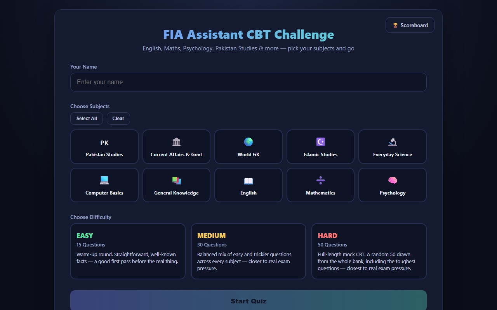
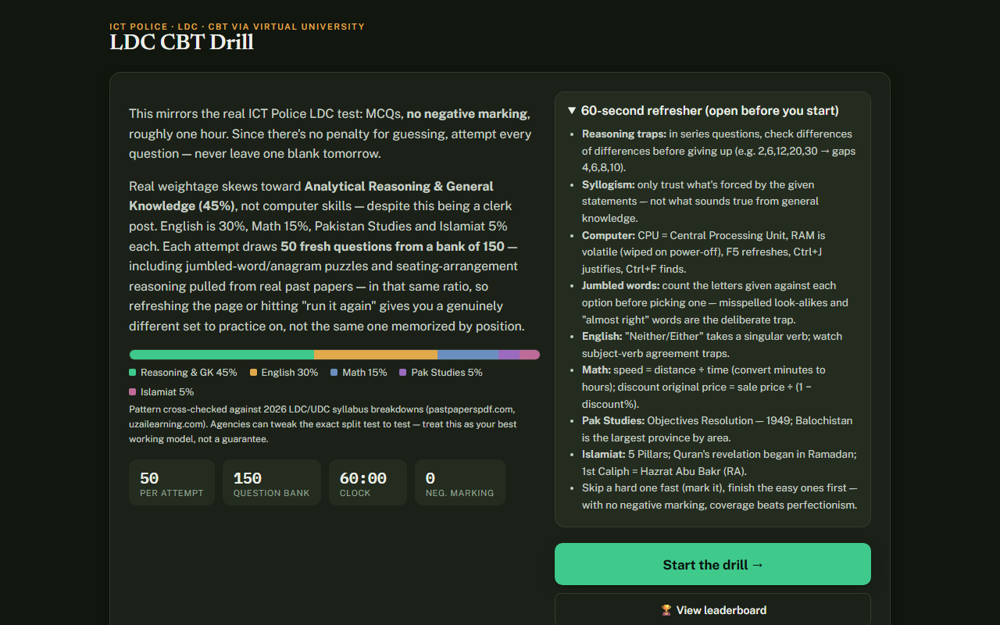

# 📝 QuizRush

**Practice tests for Pakistani government job exams, in the browser.** Pick subjects and difficulty, race the clock, and compare scores on a shared scoreboard.

🔗 **[Open QuizRush](https://umairjailani.github.io/quizrush/)** · **[Open the LDC drill](https://umairjailani.github.io/quizrush/ldc-police-drill.html)**

## Why I built it

Government job tests in Pakistan (FIA, ICT Police and others) are computer-based multiple-choice exams with a fixed mix of subjects. Practice material is mostly PDFs of past papers, with no timing, no scoring and no way to see weak areas. I wanted practice that feels like the real test.

## Two practice modes

### FIA Assistant CBT Challenge
- **10 subjects** to mix and match: Pakistan Studies, Current Affairs, World GK, Islamic Studies, Everyday Science, Computer Basics, General Knowledge, English, Mathematics and Psychology
- **3 difficulty levels:** Easy (15 questions), Medium (30) and Hard (50, a full-length mock)
- Questions are spread evenly across the subjects you choose
- **Live scoreboard** shared across devices, with a separate tab for each difficulty

### ICT Police LDC drill

- Mirrors the real LDC test: **50 questions, 60-minute clock, no negative marking**
- Each attempt draws a fresh set from a **bank of 150**, in the real subject weighting (Reasoning & GK 45%, English 30%, Math 15%, Pakistan Studies 5%, Islamiat 5%)
- Includes jumbled-word and seating-arrangement questions modelled on past papers
- A **60-second refresher** of common traps to read before starting, and a leaderboard

## How it's built

| Part | What's used |
|---|---|
| Front end | Plain HTML, CSS and JavaScript, no framework or build step |
| Scoreboard | Firebase Firestore, with security rules in [`firestore.rules`](firestore.rules) |
| Hosting | GitHub Pages |

Built with AI coding tools. I decided the test format, subject weighting and question mix, and checked the pattern against published syllabus breakdowns.

## Run it locally

Open `index.html` or `ldc-police-drill.html` in a browser. The scoreboard needs an internet connection.

> This is a personal practice project, not an official exam resource. Check content against the current official syllabus.
